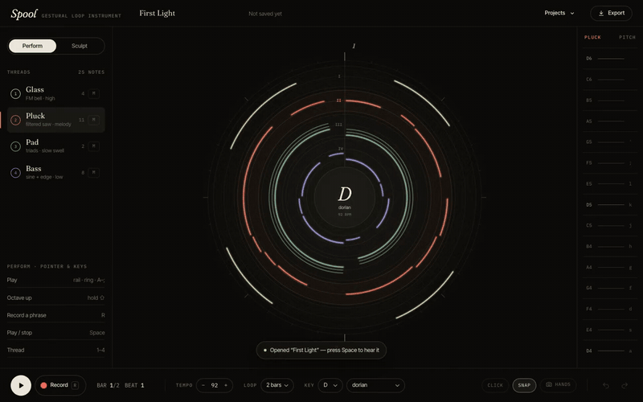
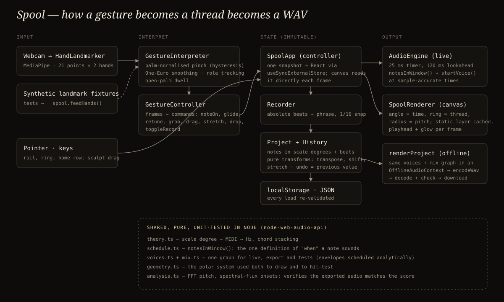

# Spool

**A gestural loop instrument.** Pinch the air to play a note — the height of your hand is the pitch. Record a phrase and it winds around a circular score as a coloured thread. Layer four threads, then grab any phrase and *sculpt* it: pull it outward to transpose, drag it around the circle to move it in time, spread two pinches to stretch it. Save it in the browser, export it as a WAV.



<sub>Silent screen recording of a real session, captured with Playwright. The WAV that session exported is in [`case-study/demos/first-light.wav`](case-study/demos/first-light.wav).</sub>

## The score

Time runs clockwise from twelve o'clock. Each ring is one thread (voice), low voices inside, high outside. Inside a ring, **distance from the centre is pitch** — so moving a phrase outward *is* transposing it, and rotating it *is* shifting it in time. Chords on the Pad thread are drawn as three strands, one per chord tone.

| Thread | Voice | Register |
|---|---|---|
| I · Glass | two-operator FM bell, decaying index | high |
| II · Pluck | saw + triangle through an enveloped low-pass | melody |
| III · Pad | detuned saws, scale-third triads, slow swell | chords |
| IV · Bass | sine body + triangle edge | low |

Pitch is stored as a **scale degree**, never a MIDI number: a hand in the air can't play a wrong note, transposition stays in key, and changing the key re-tunes the whole spool.

## Play

```bash
npm install
npm run dev        # http://localhost:5341
```

| | Hands (camera) | Pointer & keys |
|---|---|---|
| Play | pinch | press the pitch rail or the active ring; home row `A`…`'` (`⇧` = octave up) |
| Pitch | hand height | where you press |
| Louder | lean in (palm size) | — |
| Record / stop | hold the other palm open for ~1 s | `R` |
| Play / stop | — | `Space` |
| Thread | — | `1`–`4` |
| Sculpt | pinch a thread and move; pinch with both hands and spread to stretch | `E` (or the Sculpt toggle), then drag; `↑↓` transpose, `←→` shift, `[` `]` stretch, `⌫` remove |
| Undo / redo | — | `⌘Z` / `⇧⌘Z` |

Camera frames are processed locally by MediaPipe's hand landmarker (model and WASM are self-hosted); nothing is uploaded.

## How it's built



- **One definition of time.** `notesInWindow()` drives the live lookahead scheduler *and* the offline renderer, so what you hear while playing is what you get in the WAV.
- **One synth graph.** Voices and the mix (bus → dry/convolution reverb → compressor) take any `BaseAudioContext`: `AudioContext` live, `OfflineAudioContext` for export, `node-web-audio-api` in unit tests. Envelope releases are computed analytically instead of relying on `cancelAndHoldAtTime`, so they behave identically in every engine.
- **One geometry.** The polar mapping used to draw a thread is the same one used to hit-test it, so what you grab is exactly what you see.
- **Gestures are commands.** Raw landmarks → `GestureInterpreter` (palm-normalised pinch with hysteresis, One-Euro smoothing, stable hand roles) → `GestureController` (noteOn / glide / retune / grab / drag / stretch / drop) → the same app methods pointer input calls.
- **Immutable project, cheap undo.** Every edit returns a new project; history is a stack of values.

Stack: Vite, React 19, TypeScript, Web Audio API, MediaPipe Tasks Vision, Canvas 2D. Type: Fraunces, Inter Tight, IBM Plex Mono.

## Tests

```bash
npm test                 # 52 unit tests (Vitest; real DSP via node-web-audio-api)
npm run test:e2e         # 16 browser tests (Playwright, Chromium) against the dev server
E2E_PROD=1 npm run test:e2e   # same suite against the production build
npm run build
```

What's verified, and how:

- **Audio:** rendered pitch within ±15 cents of the scale degree, Pad triads contain exactly their chord tones, ADSR shape, voices stop and disconnect, muted tracks are silent, transposition and shift change the audio, renders are deterministic.
- **The whole workflow in a real browser:** play → record two layers on the beat → sculpt with an actual mouse drag → stretch → undo/redo → save → reload → export. The downloaded WAV is decoded and checked: 44.1 kHz, stereo, 16-bit PCM (also via `ffprobe`), correct duration, **every note onset where the score says it is and no stray onsets** (spectral flux), and the bass pitch at the downbeat. A second test exports with the bass muted and confirms its fundamental is gone.
- **Gestures:** synthetic MediaPipe-shaped landmarks run through the real pipeline (pinch, glide, release on hand loss, open-palm record toggle, sculpt grab/drag/two-hand stretch).
- **Camera:** with Chromium's fake camera the real MediaPipe model loads and runs (permission → loading → running → "raise a hand" coaching); a declined permission falls back to pointer & keys.
- **Layout:** every design state at 1440×900, 1280×800, 1024×768 and 390×844 with no horizontal overflow.

Not verified by automation: how the gestures feel to a real person in front of a real camera (latency, fatigue, lighting). See [PROGRESS.md](PROGRESS.md).

## Case study

[case-study/README.md](case-study/README.md) — design and engineering decisions, iterations, problems and fixes.
