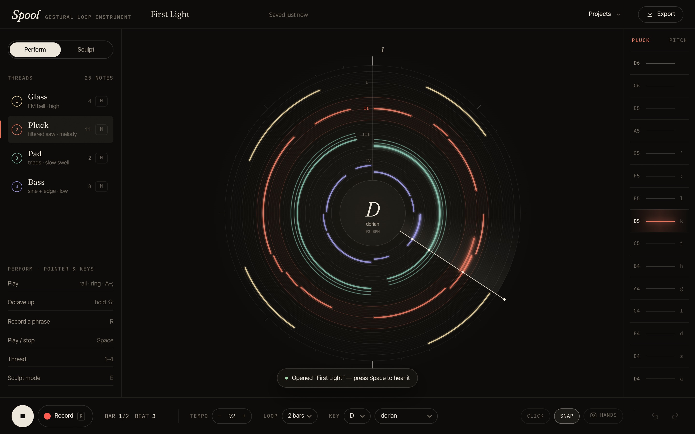
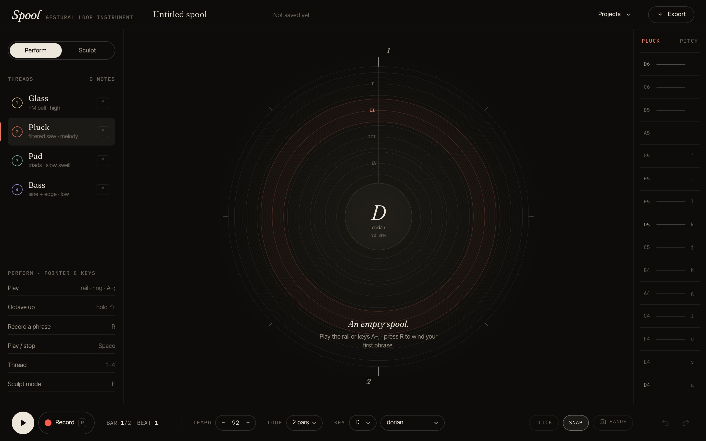
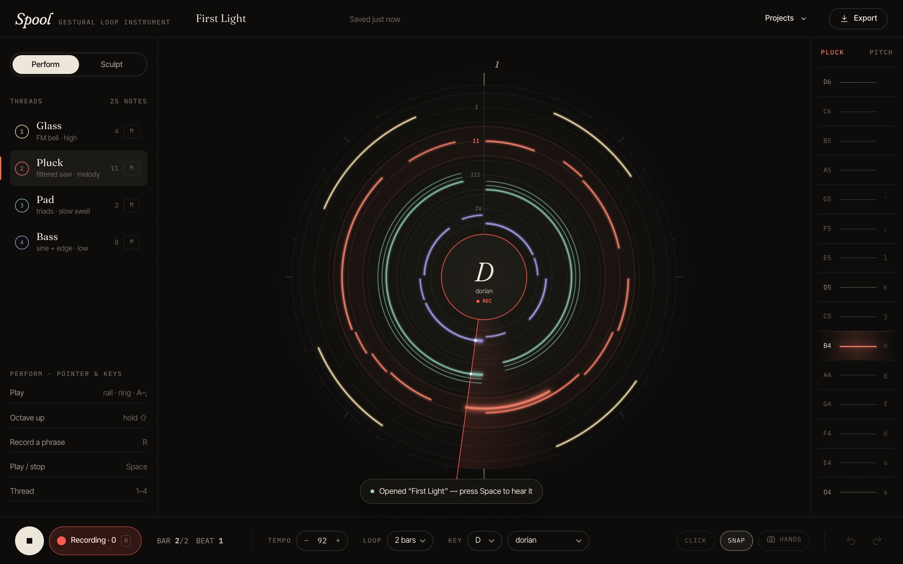
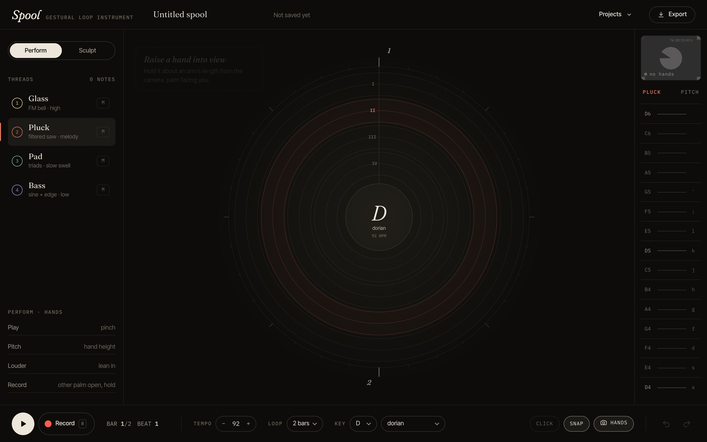
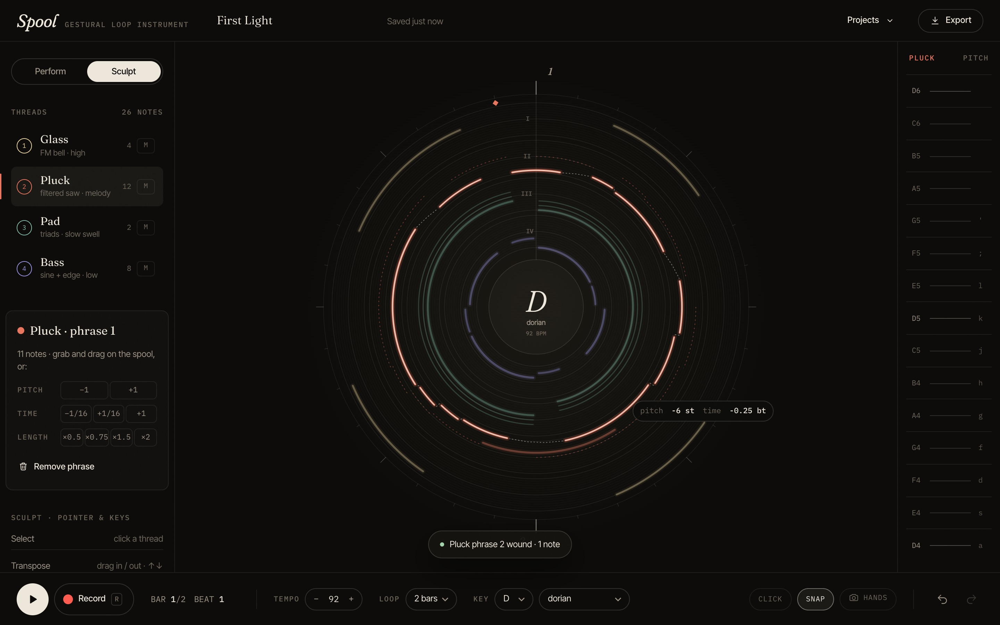
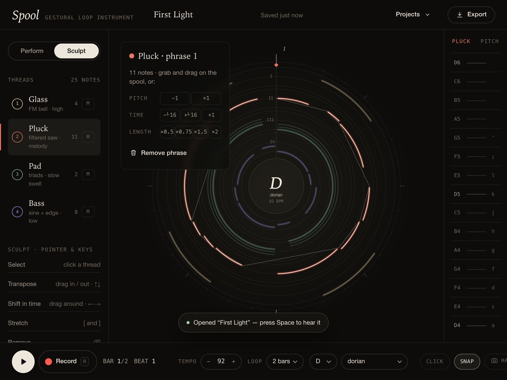
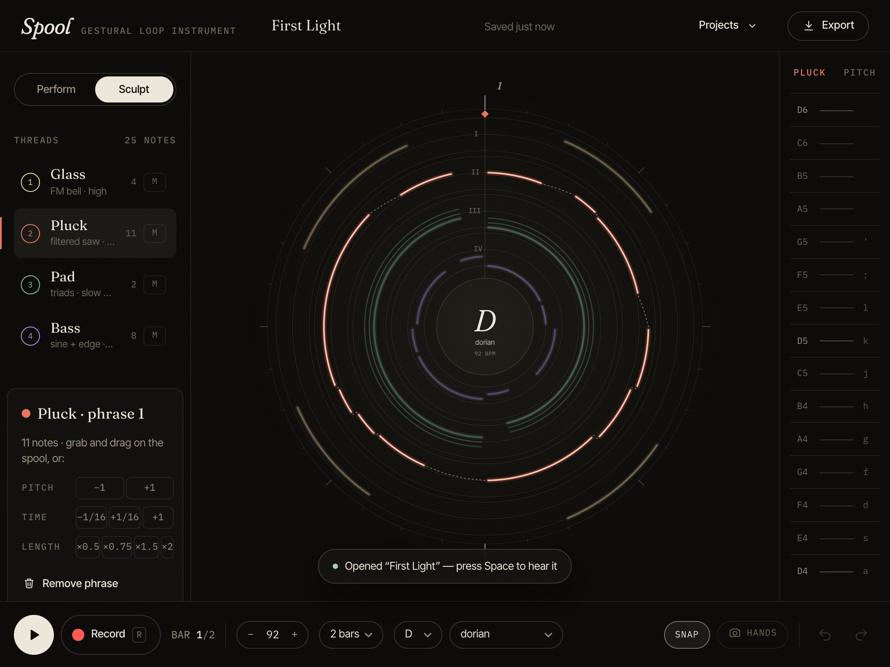

# Spool — case study

*A gestural loop instrument, designed and engineered in one sitting. Everything shown here is the real application: screenshots and the screen recording were captured from the running build by Playwright, and every test result quoted was produced by the test suite in this repository.*

---

## 1 · Premise

Loopers are usually linear: a waveform, a timeline, a grid. But a loop is a circle. It comes back around. Spool takes that literally — the score is a spool, time winds clockwise from twelve o'clock, and every phrase you record is a thread wound onto it.

The second idea is that the hand is the controller. A pinch is a note; the height of the hand is the pitch. That's an expressive input with an obvious problem — the air has no frets — so the instrument has to absorb imprecision without feeling vague.

The third idea is that once something is recorded, you shouldn't have to re-perform it to change it. You should be able to pick it up. In Sculpt mode a phrase is an object: pull it outward and it rises in pitch, rotate it and it moves in time, spread two pinches and it stretches.

## 2 · The score is the interface

The circular score encodes three musical dimensions with no legend required:

| Visual | Musical |
|---|---|
| angle (clockwise from 12) | time in the loop |
| ring (inside → out) | thread / voice, ordered by register: Bass, Pad, Pluck, Glass |
| radius within a ring | pitch (scale degree) |
| thread width | velocity |
| three parallel strands | a chord (Pad thread) — one strand per chord tone |

Because radius *is* pitch and angle *is* time, the Sculpt gestures don't need explaining: dragging a thread outward visibly raises it, and you hear it rise (each step auditions the new pitch). The graphic transformation and the musical transformation are the same transformation.

Empty rings show a faint lane for every degree — the staff lines of the instrument — so even an empty spool tells you where pitches go. The active ring is tinted in its thread colour, and the pitch rail beside the score is tinted to match.

### Recording and playback states

- **Playing:** a playhead sweeps with a soft trailing light; notes under it brighten, glow in their colour and carry a white spark exactly where the playhead crosses them.
- **Recording:** the sweep, the hub ring and the hub label turn red. Notes appear as you play them, and on the next pass they already play back (overdub).
- **Holding a note** draws a growing arc from where you pressed to the playhead. With the transport stopped, the whole circle at that pitch lights up instead — the string you're sounding.

## 3 · Visual system

**Direction.** A small instrument studio's object: dark lacquer, paper-white type, luminous but restrained thread colours. No glass panels, no gradients for decoration — the only light in the interface comes from sound (glow on sounding notes, the playhead sweep) plus a faint warm pool at the centre of the spool.

**Colour.** Ink `#0d0c0a`, paper `#ede6da`, and four thread colours chosen to be distinguishable from each other and from the red recording state: champagne (Glass), madder (Pluck), verdigris (Pad), indigo-lavender (Bass). Colour always carries meaning — thread identity, active ring, recording — never decoration.

**Type.** Three faces with distinct jobs:
- *Fraunces* (variable, soft/wonky axes, italic) — identity and musical names: the wordmark, the key in the hub, phrase titles, bar numerals on the rim.
- *Inter Tight* — controls and explanations.
- *IBM Plex Mono* — readouts and labels: tempo, bar/beat, note names on the rail, the drag readout.

**Material.** A 5 % SVG grain over everything; each thread is drawn as a soft halo, a solid core and a thin highlight on the inner edge, so it reads as a wound fibre rather than a vector stroke.

**Motion.** One spring curve (CSS `linear()`) and three durations. The mode switch thumb springs; toasts and menus pop; the landing spool unspools as it enters. Nothing animates in the audio path, and `prefers-reduced-motion` collapses the durations, removes the pulse on held notes and shortens the playhead trail.

**Progressive disclosure.** First screen: the score, two threads of controls, a rail. Sculpt controls appear only in Sculpt mode, and only for a selected phrase. Keyboard hints change with the mode and input (hands vs pointer).

## 4 · Interaction design for the hand

Raw MediaPipe landmarks are noisy and the hand is imprecise, so the gesture layer is a pipeline of small, testable decisions:

1. **Palm-normalised measurements.** Pinch distance, openness and position are divided by palm size (wrist → middle knuckle). A pinch reads the same at 40 cm or 1.5 m.
2. **Hysteresis.** A pinch closes below 0.32 palm-widths and opens above 0.50. A hand hovering at the threshold can't machine-gun notes.
3. **One-Euro filtering** of the cursor. Tuned by measuring step response: a full-rail jump settles in ~5 frames at 30 fps while ±1 % jitter is held under 0.1 %. (The first parameters took over 15 frames to settle — far too sluggish for an instrument.)
4. **Pitch hysteresis.** The hand must cross a degree boundary by 15 % of a step before the pitch changes.
5. **Stable roles.** One hand plays, the other controls. With two hands, identities follow a constant-velocity prediction, so crossing your hands doesn't swap them mid-phrase. `lefty` swaps the default.
6. **Deliberate commands.** Recording toggles only after the control hand holds an open palm for 0.9 s, with a red progress ring drawn around the palm in the camera view.
7. **Lean in to play louder.** Velocity comes from palm size (proximity to the camera).
8. **Pinch settle** — see Problems below.

Pointer and keyboard drive the same app methods: the pitch rail, the active ring itself (press on it — radius is pitch), and the home row `A`…`'`.

Camera states are designed, not defaulted: permission (with a plain statement that video never leaves the device), model loading, running-but-no-hands coaching, and declined/no-camera/failed states that offer "Continue with mouse & keys".

## 5 · Sculpt

- Grab any thread: its whole phrase (everything from one recording pass) is selected; others dim to 38 %.
- During a drag, a dashed ghost shows where the phrase was; the live preview is outlined; a dotted spiral winds between consecutive notes; a diamond on the rim marks the phrase anchor; a mono readout follows the cursor (`pitch +2 st · time +0.5 bt · len ×2`).
- **The preview is audible** — the engine plays the transformed project while you drag.
- Release commits exactly one undo step.
- Transposition is in scale degrees and clamped so the phrase stays inside the ring's range (drawing it clamped would lie). Time shifts snap to 1/16 and wrap around the loop seam. Stretch snaps to ×0.5, ×0.75, ×1.5, ×2 and scales note offsets from the phrase's anchor — so a phrase that straddles the seam still stretches coherently.
- Two-hand version: pinch to grab and move; pinch with the other hand too and spread to stretch.

## 6 · Engineering

**Pitch as scale degree.** Notes store a degree, not a MIDI number. Consequences: wrong notes are impossible, transposition stays in key, changing the key re-tunes the whole composition, and chords are just "degree, +2, +4".

**One definition of time.** `notesInWindow(project, fromBeat, toBeat)` is a pure function over an endlessly repeating loop with a half-open window (so a note on a boundary is never scheduled twice). The live scheduler (25 ms timer, 120 ms lookahead — the "two clocks" pattern) and the offline exporter both call it.

**One synth graph, three runtimes.** Voices and the mix take a `BaseAudioContext`, so the identical graph runs live, inside `OfflineAudioContext` for export, and in Node unit tests via `node-web-audio-api`. Envelopes are scheduled analytically (the release value is computed from the ADSR curve) rather than with `cancelAndHoldAtTime`, which Firefox lacks. The reverb impulse is generated from a seeded PRNG, so renders are bit-for-bit reproducible — a test asserts it.

**Recording.** The recorder works in absolute transport beats, so a note held across the loop seam keeps its real length; onsets snap to 1/16 by default. Notes become part of the playback project as soon as they're released, so the second pass of a recording already plays the first.

**State.** One immutable snapshot (React reads it through `useSyncExternalStore`); the canvas reads the controller directly every frame and caches its static layer (rings, ticks, threads) until the project or selection changes. Undo is a stack of previous values.

**Persistence and export.** Projects autosave to `localStorage`; every load and JSON import goes back through a validator (types, ranges, unique ids, track consistency, prototype-safe enum checks). WAV export renders two loops plus a tail long enough for the longest overhanging note, encodes 16-bit PCM, **decodes its own output and checks it** before offering the download, and reports duration, sample rate and peak level in the UI.

**Size.** Main bundle 299 KB (95 KB gzip). MediaPipe's JS (154 KB) is a separate chunk loaded only when the camera starts; its WASM and the 7.8 MB hand model are self-hosted.

## 7 · Proving it works

Visual tests can't tell you if an instrument plays the right notes, so the audio is tested as audio.

**Unit (52, Vitest, real DSP in Node):** rendered pitch within ±15 cents of the intended degree for each voice; Pad triads contain their chord tones and not neighbours; ADSR rises, sustains, releases to silence, and the nodes disconnect; muted tracks are silent; transposition and shifts change the actual audio; deterministic renders; WAV round-trip; scale-down instead of clipping; gesture interpreter, controller, recorder, transforms, history and validation.

**Browser (16, Playwright, real Chromium):**
- *The whole workflow* — play from the rail; record a phrase with real key presses aligned to the transport; record a second layer on another thread; confirm both threads sound together at the downbeat; switch to Sculpt and drag a phrase with the mouse by +2 steps and +1 beat; stretch ×2; undo/redo; save; reload; reopen; export. The downloaded WAV is decoded and checked: 44.1 kHz, stereo, 16-bit PCM (confirmed again by `ffprobe`), duration to 0.1 s, **an onset at every beat the score says and no onsets anywhere else**, and the bass pitch at the downbeat.
- *Mute* — the bass fundamental is present in one export and absent after muting.
- *Gestures* — synthetic MediaPipe-shaped hands sent through the real pipeline: pinch/height/glide/release, release when the hand disappears, open-palm recording of a three-note phrase, sculpt grab/drag/two-hand stretch.
- *Camera* — Chromium's fake camera with the real MediaPipe model: permission → loading → running → coaching; declined permission → fallback.
- *Keyboard* — Stop silences every voice; Tab navigates; Enter mutes from the keyboard; Space after a mouse click still means play.
- *Layout* — every state at 1440×900, 1280×800, 1024×768 and 390×844 with no horizontal overflow (screenshots in this folder come from this run).

The suite passes against both the dev server and the production build.

## 8 · Problems, and what fixed them

**The onset detector lied — twice.** The first export check used energy ratios and missed a pluck attack masked by a sustained bass note. Spectral flux on log magnitudes found it, but also found phantom onsets in the bass decay, which made "is there an onset near t?" too lenient. A relative floor then hid the quiet bass onsets entirely. Square-root-compressed flux with a median-plus-relative threshold, and a lead-in so a note at t = 0 has a "before" frame, finally reported exactly the ten expected onsets and nothing else — and the test was tightened to fail on any stray onset.

**Pinching while moving recorded two notes.** The synthetic-gesture test produced `[3, 2, 5, 8]` instead of three notes: as a pinch closes, the pinch point (between thumb and index) is still moving, and the smoothed pitch settles a frame later — so the controller "glided" into a new note. Fix: for 120 ms after a pinch, a pitch change **retunes** the note (the abandoned one is never recorded) instead of gliding.

**Stop didn't stop.** An independent review found that the scheduler releases each queued note at its planned end, and `release()` ignored later calls — so Stop was a no-op and long pad notes rang for seconds. Voices now accept an earlier release (with a short fade for Stop) and never start if stopped before their onset. Regression tests at both levels: an offline render, and a browser test that waits for the active-voice count to reach zero after Stop.

**The same review** caught a camera stream that could stay on if you cancelled during startup, gesture notes that could hang if the tab was hidden, notes double-scheduled when the loop length changed mid-playback, a `value in SCALES` check that accepted `"constructor"`, and keyboard focus problems. All fixed with tests where testable.

**`:focus-visible` can't tell how focus arrived.** To let Space mean "play" after you click a button with the mouse, but "activate" when you tabbed to it, the first fix checked `:focus-visible` — but Chromium turns it on as soon as *any* key is pressed. The app now records input modality at focus time.

**Layout.** The overflow test caught the landing visual refusing to shrink (a canvas inside a grid item without `min-width: 0`), the transport pushing undo/redo off-screen at 1280 px, and the mobile pitch strip forcing a 450 px minimum width.

### A visual iteration

| Before (commit `a01188d`) | After |
|---|---|
|  |  |

At 1024 px the floating Sculpt panel covered the outer ring, the phrase connector cut straight chords across the circle, the transport ran off the right edge, and `⅟16` rendered as a broken glyph. The panel moved into the side column (it can never cover the score), the connector became a spiral that winds forward in time, and the transport compacts at medium widths.

## 9 · What isn't verified

- **Real hands.** Every gesture path is tested with synthetic landmarks and the real model runs in CI-style tests, but no person has played Spool with a real camera during this build. Latency from pinch to sound, fatigue, lighting robustness and the tuning of the thresholds need a human session.
- **Browsers.** Automated tests run in Chromium. The audio code avoids Chromium-only APIs (no `cancelAndHoldAtTime`; conic gradients are feature-detected), but Firefox and Safari were not exercised.
- **Mobile.** The layout is designed for and tested at 390×844 with touch-sized targets; camera play on phones is untested, and the key selector is hidden on phones.
- **No user research** was conducted; nothing here should be read as user-tested.

## 10 · Credits

- [MediaPipe Tasks Vision](https://developers.google.com/mediapipe) hand landmarker — Apache-2.0.
- Fraunces, Inter Tight, IBM Plex Mono via Fontsource — SIL Open Font License.
- One-Euro filter: Casiez, Roussel & Vogel, *1€ Filter*, CHI 2012.
- `node-web-audio-api` (test-time Web Audio in Node), `ffmpeg-static`/`ffprobe-static` (test-time verification).

All application code in this repository was written for Spool.

### Files

- `screenshots/` — every design state at 1440×900, plus 1024×768 and 390×844 samples.
- `demos/session.mp4`, `session.gif` — silent screen recording of a real session (demo playback → recording a Glass phrase over it → sculpting it → export).
- `demos/first-light.wav` — the WAV that session exported, untouched.
- `diagrams/architecture.svg`
